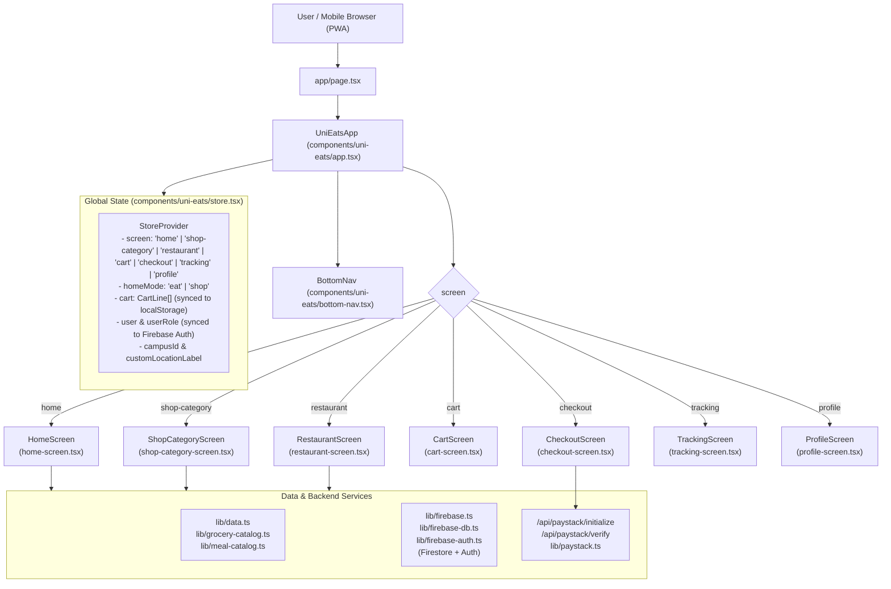

# Dash — Project Architecture & Codebase Guide

Welcome to **Dash** (`Good food. Great times.`). This document provides a simple, structured guide to how the application is built, where every feature lives, and how all parts connect.

---

## 1. High-Level Architecture & Flow



---

## 2. Directory Structure Map

```text
uni-eats/
├── app/                              # Next.js App Router (Routes & APIs)
│   ├── (auth)/                       # Authentication pages (login, signup)
│   │   ├── login/page.tsx            # Student & Merchant Login
│   │   └── signup/page.tsx           # New User Registration
│   ├── api/                          # Backend API Routes
│   │   └── paystack/
│   │       ├── initialize/route.ts   # Initializes Paystack transaction with HMAC signature
│   │       ├── verify/route.ts       # Server-side authoritative price verification
│   │       └── webhook/route.ts      # Paystack event webhooks
│   ├── store-owner/page.tsx          # Merchant/Store Owner Dashboard (Products, Orders, Store Settings)
│   ├── layout.tsx                    # Root HTML layout, font setup, PWA metadata
│   ├── page.tsx                      # Root entry point — mounts the Dash app shell
│   ├── manifest.ts                   # Web App Manifest (PWA config & icons)
│   └── globals.css                   # Global styles & Tailwind v4 theme definitions
│
├── components/                       # UI Components
│   ├── icons.tsx                     # Reusable SVG icon set (Search, Bag, Star, Pin, etc.)
│   └── uni-eats/                     # Main Application Components & Screens
│       ├── app.tsx                   # Main student shell & screen switcher
│       ├── store.tsx                 # Central React Context state store (Single Source of Truth)
│       ├── bottom-nav.tsx            # Sticky bottom navigation bar (Home, Cart, Orders, Account)
│       ├── home-screen.tsx           # Main homepage (Eat / Shop toggle, promos, rails, stores)
│       ├── shop-category-screen.tsx  # Checkers Sixty60-style category/aisle browsing page
│       ├── restaurant-screen.tsx     # Single store / restaurant menu page
│       ├── product-card.tsx          # E-commerce product card with stepper and detail bottom sheet
│       ├── cart-screen.tsx           # Shopping cart view with item list and order summary
│       ├── checkout-screen.tsx       # Checkout & payment screen (Paystack / Cash on pickup)
│       ├── tracking-screen.tsx       # Live order tracking and pickup status
│       ├── profile-screen.tsx        # Customer account, auth state, and past orders
│       ├── sheet.tsx                 # Base modal bottom-sheet component
│       ├── item-sheet.tsx            # Meal modifier & customization bottom sheet
│       └── redirect-logged-in-owner.tsx # Role-based auto-redirect helper
│
├── lib/                              # Core Logic, Catalogs & Services
│   ├── data.ts                       # Base types (MenuItem, Restaurant), default data & locations
│   ├── grocery-catalog.ts            # Dash Market catalog (41 products across 6 departments)
│   ├── meal-catalog.ts               # Meal categories (Burgers, Kotas, Chicken, Pizza, etc.) & helpers
│   ├── firebase.ts                   # Firebase App, Auth, Firestore & Storage initialization
│   ├── firebase-db.ts                # SWR hooks, Firestore queries (fetch restaurants, orders, products)
│   ├── firebase-auth.ts              # User roles ('customer' | 'merchant'), login/signup methods
│   ├── paystack.ts                   # Paystack client & server-side HMAC validation helpers
│   └── utils.ts                      # Tailwind cn() className merger utility
│
├── public/                           # Static Assets
│   ├── dash-logo.jpg                 # Brand logo
│   ├── sw.js                         # Service Worker for PWA offline support
│   ├── categories/                   # Crisp vector SVGs for category tiles
│   │   ├── bread-milk.svg
│   │   ├── fresh-produce.svg
│   │   ├── butcher.svg
│   │   ├── snacks-drinks.svg
│   │   ├── pantry.svg
│   │   ├── household.svg
│   │   ├── meal-burgers.svg
│   │   ├── meal-kotas.svg
│   │   ├── meal-chicken.svg
│   │   ├── meal-pizza.svg
│   │   ├── meal-bowls.svg
│   │   └── meal-wraps.svg
│   ├── products/                     # Studio packshots for grocery items (.jpg and .svg)
│   └── food/                         # High-res photography for meals & restaurants
│
└── package.json                      # Project dependencies & npm scripts
```

---

## 3. How the App Connects & Works

### 1. The Screen Navigation Architecture
Dash is designed as a smooth, app-like mobile experience using a single root container ([`components/uni-eats/app.tsx`](components/uni-eats/app.tsx)):
- The `screen` state is managed in [`components/uni-eats/store.tsx`](components/uni-eats/store.tsx) and can be set to:
  - `'home'`: Homepage with the **Eat (Meals)** and **Shop (Stores)** segmented toggle.
  - `'shop-category'`: Dedicated category page for grocery departments or meal types.
  - `'restaurant'`: Dedicated store menu page when a user taps on a restaurant or spaza shop.
  - `'cart'`: Active cart summary with quantities and price breakdowns.
  - `'checkout'`: Delivery/pickup instructions and payment triggers.
  - `'tracking'`: Live order status (`pending` -> `preparing` -> `ready` -> `completed`).
  - `'profile'`: Account details, login prompt, or link to merchant dashboard.
- Switching screens is done by calling `goToScreen('cart')` or `openDepartment('bread-milk')`.

### 2. State Management (`components/uni-eats/store.tsx`)
This is the heart of the client-side app:
- **Cart**: Stored in React state and automatically persisted to `localStorage` under `unieats_cart`.
  - **Single Store Rule**: Cart lines belong to one store at a time. Adding an item from a different store prompts the user before clearing the previous cart.
  - **Image Safety**: Every item added to the cart is normalized so `image` is always a valid string, preventing Next.js preload errors.
- **Location**: Manages either a predefined hub (e.g., Doornfontein, Auckland Park) or custom GPS/address string.
- **Authentication**: Listens to Firebase Auth state via `onAuthStateChanged()`. If the logged-in user is a merchant, they are automatically routed to `/store-owner`.

### 3. Data Integration (`lib/firebase-db.ts` & `lib/data.ts`)
- **Live Firestore First**: `useFirebaseRestaurants()` in [`lib/firebase-db.ts`](lib/firebase-db.ts) fetches live merchant stores and products created via the merchant portal.
- **Default Catalog Fallback**: If the database has no live restaurants, it falls back to `defaultRestaurants` in [`lib/data.ts`](lib/data.ts).
- **Dash Market**: Groceries are unified under `Dash Market` ([`lib/grocery-catalog.ts`](lib/grocery-catalog.ts)), allowing a single seamless cart across all grocery departments.

### 4. Checkers Sixty60-Style Shopping & Product Cards
- [`components/uni-eats/product-card.tsx`](components/uni-eats/product-card.tsx):
  - Renders a clean 2-column e-commerce tile with an instant `+` / `– 1 +` stepper.
  - Automatically displays red `Save R...` badges when `oldPrice > price`.
  - Clicking any card opens `ProductSheet` with high-res images, pack size, and full description.

### 5. Payments & Security
- Handled in [`components/uni-eats/checkout-screen.tsx`](components/uni-eats/checkout-screen.tsx).
- When a user chooses **Paystack**:
  1. The client calls `/api/paystack/initialize` with the cart details.
  2. The server authoritatively calculates the total from the database (preventing client price tampering) and returns an access code.
  3. The Paystack inline modal opens.
  4. On completion, `/api/paystack/verify` confirms the transaction signature before creating the order in Firestore.

---

## 4. Quick Reference: Where to Make Changes

| If you want to... | Edit this file |
| :--- | :--- |
| **Add or edit grocery items** | [`lib/grocery-catalog.ts`](lib/grocery-catalog.ts) |
| **Add or edit default meals / restaurants** | [`lib/data.ts`](lib/data.ts) |
| **Add or customize meal categories** | [`lib/meal-catalog.ts`](lib/meal-catalog.ts) |
| **Change the homepage layout** | [`components/uni-eats/home-screen.tsx`](components/uni-eats/home-screen.tsx) |
| **Change category browsing / aisles** | [`components/uni-eats/shop-category-screen.tsx`](components/uni-eats/shop-category-screen.tsx) |
| **Modify how products look on cards** | [`components/uni-eats/product-card.tsx`](components/uni-eats/product-card.tsx) |
| **Change Cart or Checkout rules** | [`components/uni-eats/cart-screen.tsx`](components/uni-eats/cart-screen.tsx) & [`components/uni-eats/checkout-screen.tsx`](components/uni-eats/checkout-screen.tsx) |
| **Modify the Merchant Portal** | [`app/store-owner/page.tsx`](app/store-owner/page.tsx) |
| **Add a new global screen** | Add to `Screen` type in [`components/uni-eats/store.tsx`](components/uni-eats/store.tsx) and add a `case` in [`components/uni-eats/app.tsx`](components/uni-eats/app.tsx) |
| **Change theme colors & branding** | [`app/globals.css`](app/globals.css) and `/public/dash-logo.jpg` |

---

## 5. Key Rules & Best Practices

1. **Images in Next.js (`<Image />`)**:
   - Always ensure `src` is non-empty. Never pass `src=""` or `src={undefined}` to Next.js `<Image>`, as Next.js calls `ReactDOM.preload()` which will throw a browser console error.
   - Use `ProductImage` in [`components/uni-eats/product-card.tsx`](components/uni-eats/product-card.tsx) whenever displaying menu or grocery items.
2. **Preserving Docstrings & Types**:
   - Maintain TypeScript interfaces in [`lib/data.ts`](lib/data.ts) (`MenuItem`, `Restaurant`, `Campus`).
3. **Cart Persistence**:
   - When modifying cart behavior in [`components/uni-eats/store.tsx`](components/uni-eats/store.tsx), test that items persist on page refresh via `localStorage`.

