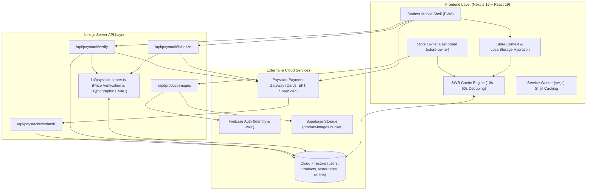
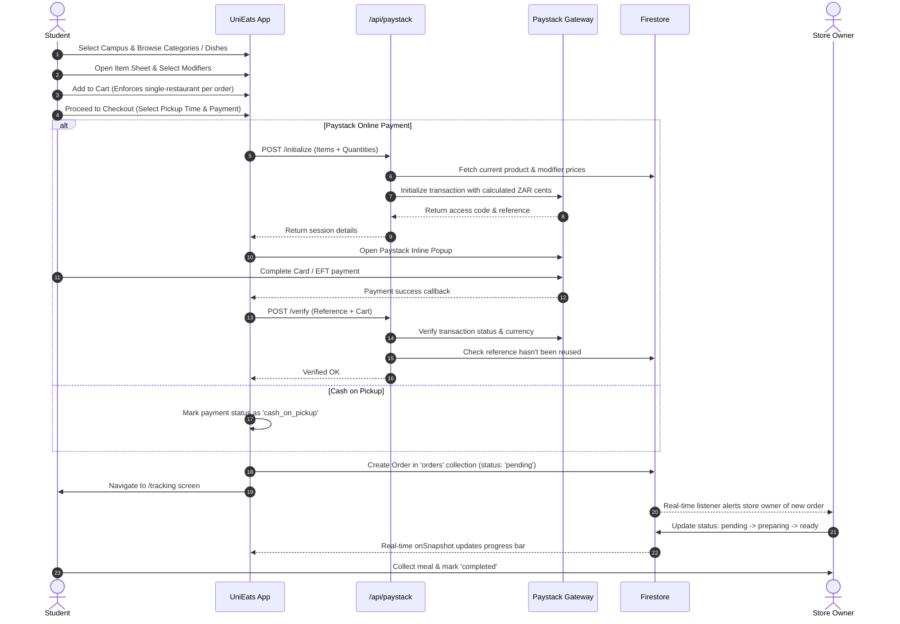
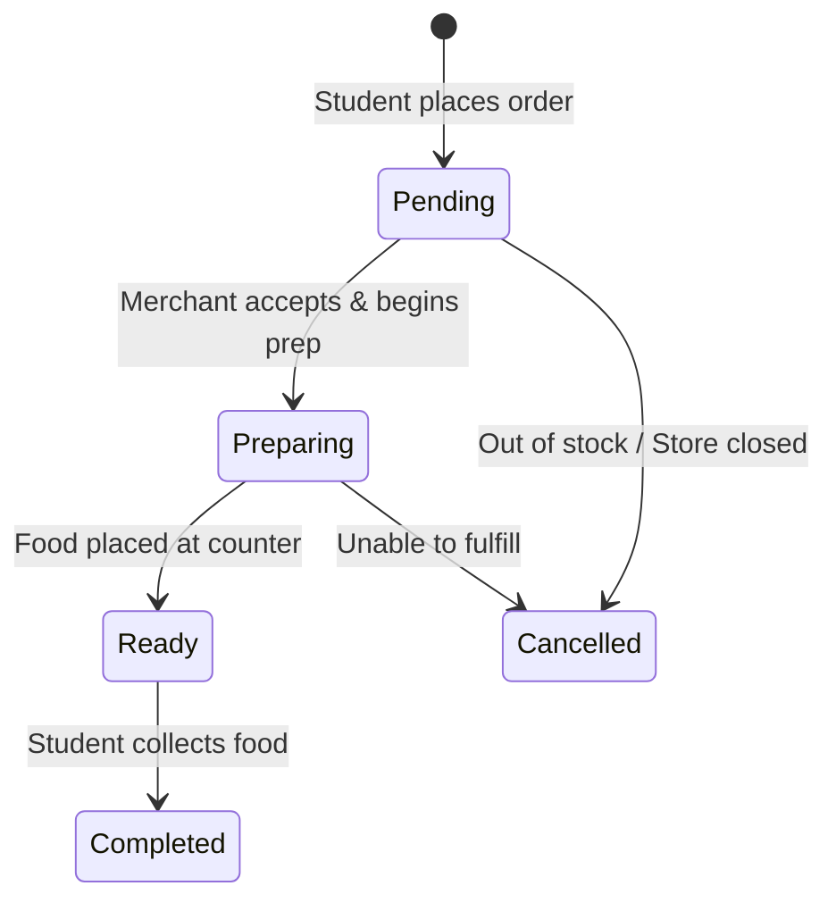

# UniEats — Campus Food Ordering Platform

[](https://nextjs.org/)
[](https://react.dev/)
[](https://www.typescriptlang.org/)
[](https://tailwindcss.com/)
[](https://firebase.google.com/)
[](https://supabase.com/)
[-00C3F7?style=flat)](https://paystack.com/)
[](https://web.dev/progressive-web-apps/)

**UniEats** is a full-stack, mobile-first Progressive Web Application (PWA) designed specifically for university campuses. It bridges the gap between busy university students and on-campus food merchants, facilitating fast meal discovery, menu customizations, online payments in South African Rands (ZAR), and live kitchen order tracking.

---

## Table of Contents

1. [System Architecture Overview](#system-architecture-overview)
2. [Technology Stack](#technology-stack)
3. [Key Features & Capabilities](#key-features--capabilities)
4. [User Roles & Workflows](#user-roles--workflows)
   - [Student Experience](#1-student-experience)
   - [Store Owner / Merchant Experience](#2-store-owner--merchant-experience)
5. [Data Models & Database Schema](#data-models--database-schema)
   - [Firestore Collections](#firestore-collections)
   - [TypeScript Core Interfaces](#typescript-core-interfaces)
6. [Security & Anti-Fraud Architecture](#security--anti-fraud-architecture)
   - [Authoritative Price Verification](#authoritative-price-verification)
   - [Paystack Integrity Hash & Verification](#paystack-integrity-hash--verification)
   - [Replay Attack Mitigation](#replay-attack-mitigation)
   - [Timing-Safe Webhook Reconciliation](#timing-safe-webhook-reconciliation)
7. [API Routes & Endpoints](#api-routes--endpoints)
8. [Progressive Web App (PWA) & Offline Shell](#progressive-web-app-pwa--offline-shell)
9. [Project Directory Structure](#project-directory-structure)
10. [Environment Variables Reference](#environment-variables-reference)
11. [Setup & Installation Guide](#setup--installation-guide)
12. [Third-Party Services Configuration](#third-party-services-configuration)
    - [Firebase Setup (Auth & Firestore)](#firebase-setup)
    - [Supabase Setup (Storage Bucket)](#supabase-setup)
    - [Paystack Setup (Payment Gateway)](#paystack-setup)
13. [Deployment](#deployment)
14. [Troubleshooting & FAQs](#troubleshooting--faqs)

---

## System Architecture Overview



---

## Technology Stack

| Layer | Technology | Details |
|---|---|---|
| **Framework** | Next.js 16.2.6 (App Router) | Server Components, Server-side API Route Handlers, Turbopack |
| **Language** | TypeScript 5.7.3 | Strict type validation across all models and endpoints |
| **UI Library** | React 19.0.0 | Hooks, Transitions, Context API |
| **Styling** | Tailwind CSS v4.3.3 | PostCSS `@tailwindcss/postcss`, OKLCH dynamic color palettes |
| **Primitives** | `@base-ui/react` | Accessible headless components |
| **Data Fetching** | SWR 2.2.5 | Stale-while-revalidate client cache, request deduplication |
| **Icons** | Lucide React + Custom Icons | Highly optimized SVG icons |
| **Database** | Firebase Firestore (10.12.0) | Real-time document storage for users, products, stores, and orders |
| **Authentication** | Firebase Auth | Email & Password, ID tokens, custom client-side role enforcement |
| **Image Storage** | Supabase Storage / Firebase Storage | Direct multipart upload via internal API proxy, with HTML5 canvas fallback |
| **Payments** | Paystack South Africa (ZAR) | Inline popups, server verification, HMAC signatures, webhooks |
| **PWA** | Custom Service Worker (`sw.js`) | Offline app shell precaching, app manifest metadata |
| **Analytics** | `@vercel/analytics` | Real-time traffic and performance monitoring |

---

## Key Features & Capabilities

- **Campus-Centric Food Discovery**: Filter stores and trending meals by campus (Auckland Park Kingsway, Doornfontein, Soweto, and Bunting Road).
- **Dynamic Product Customization**: Custom meal modifier groups with single-choice selection (e.g. Choose your protein) and multiple-choice add-ons (e.g. Extra cheese, avocado, bacon).
- **Single-Merchant Order Integrity**: Safeguards that prevent students from mixing products from multiple restaurants in a single checkout session.
- **Authoritative Price Locking**: Cart prices submitted by the client are cross-verified on the server against the Firestore product collection before any transaction is initialized or verified.
- **Flexible Payments**: Support for instant card payments, EFT, and SnapScan via Paystack, as well as Cash on Pickup.
- **Real-Time Order Tracking**: 4-step progress monitor (`pending` $\to$ `preparing` $\to$ `ready` $\to$ `completed`) driven by Firestore `onSnapshot` subscriptions.
- **Comprehensive Merchant Dashboard**:
  - Live order management with sound alerts and one-click status transitions.
  - Product creation and catalog management with multiple photo uploads and modifier configuration.
  - Fast inline price updates and full product modifications.
  - Store profile customization (Campus location, prep times, open/close status).
- **Progressive Web App**: Installs natively to Android and iOS home screens, runs in standalone portrait orientation, and provides offline fallback for the application shell.

---

## User Roles & Workflows

### 1. Student Experience



#### Student Screens:
1. **Home Screen (`home-screen.tsx`)**:
   - Header with active campus selector (APK, DFC, SWC, BRC).
   - Search bar querying restaurant names, cuisines, dish names, and descriptions.
   - Horizontal category pills (Burgers, Kotas, Chicken, Pizza, Shisa Nyama, Vetkoek, Bowls, Wraps, Breakfast, Drinks, Salads, Desserts).
   - "Trending Meals" carousel with quick-add functionality.
   - List of open campus food outlets with rating, delivery/prep time, and price tier.
2. **Restaurant Detail Screen (`restaurant-screen.tsx`)**:
   - Store banner, location, cuisine tag, and prep time indicator.
   - Category navigation tabs to jump across sections.
   - Menu cards displaying meal photos, descriptions, and base prices.
3. **Item Customization Sheet (`item-sheet.tsx`)**:
   - High-resolution food preview.
   - Dynamic modifier groups:
     - Single select radio options (e.g. choice of chicken, steak, tofu).
     - Multi-select checkboxes with incremental pricing (e.g. +R 10.00 for extra cheese).
   - Quantity selector with live price calculation.
4. **Cart Screen (`cart-screen.tsx`)**:
   - Item list with selected modifiers.
   - Increment, decrement, and item removal controls.
   - Subtotal, Campus Service Fee (fixed at R 0.99), and Final Total.
   - Cross-restaurant conflict handling (alerts student if adding from another store).
5. **Checkout Screen (`checkout-screen.tsx`)**:
   - Pickup time selector ("As soon as possible", "In 15 minutes", "In 30 minutes", "In 1 hour").
   - Payment method toggle: Paystack (Online) or Cash on Pickup.
   - Secure Paystack inline checkout trigger and server verification.
6. **Live Tracking Screen (`tracking-screen.tsx`)**:
   - Order display ID and pickup time.
   - 4-stage tracking indicator:
     - Stage 1: Order confirmed
     - Stage 2: Preparing your food
     - Stage 3: Ready for pickup
     - Stage 4: Collected
   - Store location details and items recap.
   - Student confirmation button to finalize pickup.
7. **Profile & Auth Screen (`profile-screen.tsx` / `(auth)/login` / `(auth)/signup`)**:
   - Student authentication, campus affiliation, and past order history.

---

### 2. Store Owner / Merchant Experience

The merchant workspace is hosted at `/store-owner`. Access is restricted to accounts with the `merchant` role. If a merchant logs in via the student interface, they are immediately redirected to `/store-owner`.



#### Merchant Capabilities:
- **Orders Tab**:
  - Live incoming order queue with visual badges for `pending`, `preparing`, `ready`, and `completed`.
  - Filter orders by status or search by customer name / Order ID.
  - Quick action buttons to advance order stages.
  - KPI summary bar showing:
    - **Total Revenue (ZAR)**
    - **Orders Today**
    - **Active Products**
    - **Pending Order Count**
- **Products Tab**:
  - Grid view of all items sold by the store.
  - **Add Product Modal**:
    - Product title, description, category, and price.
    - Multiple image upload (supports Supabase Storage, Firebase Storage, and canvas fallback).
    - Custom modifier builder: Add single-choice or multi-choice groups with individual option labels and prices.
  - **Fast Price Edit**: Click the price tag to modify product pricing on the fly without entering a full modal.
  - **Full Edit Modal**: Update image sets, categories, modifiers, and descriptions.
  - **Delete Product**: Removes item and triggers immediate cache mutation via SWR.
- **Store Settings Tab**:
  - Store Name and Display Cuisine.
  - Campus affiliation (APK, DFC, SWC, BRC).
  - Specific counter/hall location (e.g. Student Centre, Hall 2 Counter 4).
  - Average pickup turnaround estimate (e.g. 10-15 min).
  - Open / Closed toggle.
- **Account Tab**:
  - Merchant credentials, session sign-out, and quick links.

---

## Data Models & Database Schema

UniEats utilizes Firebase Cloud Firestore as its primary document database.

### Firestore Collections

```
firestore/
├── users/
│   └── {userId}                # User profiles (Student or Merchant)
├── products/
│   └── {productId}             # Individual menu items created by merchants
├── restaurants/
│   └── {restaurantId}          # Store profiles (synced with merchantId)
└── orders/
    └── {orderId}               # Customer orders with items, totals, & payment metadata
```

---

### TypeScript Core Interfaces

#### 1. User Document (`users/{userId}`)
```typescript
export type UserRole = 'student' | 'merchant'

export interface UserDocument {
  uid: string
  name: string
  email: string
  role: UserRole                 // 'student' | 'merchant'
  phone?: string
  campusId?: string              // 'aucklandpark' | 'doornfontein' | 'soweto' | 'buntingroad'
  storeName?: string             // Present when role === 'merchant'
  storeLocation?: string         // Campus building or booth details
  pickupTime?: string            // Default prep time estimate
  firstName?: string
  lastName?: string
  studentId?: string
  createdAt?: number
}
```

#### 2. Product Document (`products/{productId}`)
```typescript
export interface ModifierOption {
  id: string
  label: string
  price: number                  // Additional price in ZAR (0 for included)
}

export interface ModifierGroup {
  id: string
  title: string
  required: boolean
  type: 'single' | 'multi'
  options: ModifierOption[]
}

export interface ProductDoc {
  id: string
  merchantId: string             // Firebase UID of the store owner
  name: string
  description: string
  price: number                  // Base price in ZAR
  category: string               // e.g. 'Burgers', 'Kotas', 'Drinks'
  images: string[]               // Array of remote URLs or base64 fallbacks
  modifierGroups?: ModifierGroup[]
  createdAt: number
  updatedAt?: number
}
```

#### 3. Restaurant Document (`restaurants/{restaurantId}`)
```typescript
export interface Restaurant {
  id: string                     // Corresponds to merchant's Firebase UID
  name: string                   // Store business name
  cuisine: string                // Primary food category
  image: string                  // Main banner or primary product thumbnail
  rating: number                 // Customer satisfaction rating (e.g. 4.8)
  reviews: number                // Review count
  pickupTime: string             // e.g. "10-15 min"
  priceLevel: string             // e.g. "R 45.00"
  location: string               // e.g. "APK Student Centre, Food Court"
  open: boolean                  // Operational status
  campusIds: string[]            // Campuses serviced by this store
  menu: MenuItem[]               // Aggregated products
}
```

#### 4. Order Document (`orders/{orderDocId}`)
```typescript
export type OrderStatus = 'pending' | 'preparing' | 'ready' | 'completed' | 'cancelled'

export interface OrderItem {
  id: string                     // Product ID
  name: string
  price: number                  // Unit price including selected modifiers
  quantity: number
  modifiers?: Array<{ label: string; price: number }>
}

export interface Order {
  id: string                     // Firestore auto-generated document ID
  orderId?: string               // Human-readable code, e.g. "UE-4921"
  customerId: string             // Firebase UID of student (or 'guest-user')
  customerName: string
  merchantId: string             // Firebase UID of receiving store
  merchantName: string
  items: OrderItem[]
  total: number                  // Authoritative total in ZAR (items + R 0.99 service fee)
  status: OrderStatus
  paymentReference?: string      // Paystack transaction reference (e.g. "UE_1730000000_abcd")
  paymentStatus?: 'paid' | 'pending' | 'cash_on_pickup'
  paymentChannel?: string        // 'paystack' | 'cash' | 'card' | 'eft'
  pickupTime?: string            // e.g. "In 15 minutes"
  notes?: string
  createdAt: any                 // Firestore serverTimestamp
  updatedAt: any                 // Firestore serverTimestamp
}
```

---

## Security & Anti-Fraud Architecture

Payment tampering and client-side balance spoofing are critical attack vectors in campus ordering apps. UniEats enforces a four-tier server-side security model:

```
[Client Cart] 
      │ (Sends item IDs + quantity)
      ▼
[/api/paystack/initialize] ────► [Firestore Products Lookup]
      │                                    │
      ├────────────────────────────────────┘ (Recalculates actual total in ZAR cents)
      ▼
[Paystack API] (Initializes locked amount + HMAC hash in metadata)
      │
      ▼
[/api/paystack/verify] ────────► [Check Reference Replay in Firestore]
      │                                    │
      ├────────────────────────────────────┘ (Re-computes total & verifies status == 'success')
      ▼
[Order Created] (Status: 'paid')
```

### 1. Authoritative Price Verification
Client applications should never be trusted with price calculations. When checkout starts:
1. The client sends `{ items: [{ itemId, quantity, modifierLabels }] }`.
2. The server (`lib/paystack-server.ts`) queries Firestore `products` collection directly for each `itemId`.
3. It extracts the official `basePrice` and loops through `modifierGroups` to find the exact price matching each selected modifier label.
4. It enforces:
   $$\text{Total Cents} = \left(\sum (\text{Base Price} + \text{Modifier Prices}) \times \text{Quantity} + \text{R 0.99}\right) \times 100$$
5. Even if a malicious actor modifies the DOM or localStorage cart prices, the transaction will be charged at the database price.

### 2. Paystack Integrity Hash & Verification
During initialization, the server generates an HMAC-SHA256 signature using the secret key:
```typescript
const integrityHash = crypto
  .createHmac('sha256', secretKey)
  .update(`${reference}:${amountInCents}:ZAR`)
  .digest('hex')
```
This signature is embedded inside Paystack's transaction `metadata`. When the transaction completes, the verify route ensures the returned amount and metadata match the expected calculation.

### 3. Replay Attack Mitigation
To prevent an attacker from reusing a single valid payment reference across multiple orders:
```typescript
export async function isReferenceAlreadyUsed(reference: string): Promise<boolean> {
  const ordersRef = collection(db, 'orders')
  const q = query(ordersRef, where('paymentReference', '==', reference))
  const snap = await getDocs(q)
  return !snap.empty
}
```
If the reference exists in any prior order document, verification immediately aborts with HTTP 409 Conflict.

### 4. Timing-Safe Webhook Reconciliation
Paystack sends asynchronous webhook events (e.g. `charge.success`). The webhook endpoint at `/api/paystack/webhook` validates the `x-paystack-signature` header using `crypto.timingSafeEqual` against the HMAC-SHA512 of the raw request body:
```typescript
const expectedHash = crypto
  .createHmac('sha512', secretKey)
  .update(rawBody)
  .digest('hex')

if (!verifyTimingSafeHash(expectedHash, signature.trim())) {
  return NextResponse.json({ error: 'Invalid signature' }, { status: 401 })
}
```
This protects against timing attacks and ensures that orders are updated safely even if the user closes their browser before returning to the app.

---

## API Routes & Endpoints

### 1. `POST /api/paystack/initialize`
Initializes a secure Paystack payment session on the server.

- **Headers**: `Content-Type: application/json`
- **Body**:
  ```json
  {
    "email": "student@student.uj.ac.za",
    "amountZar": 85.99,
    "items": [
      {
        "itemId": "prod_12345",
        "quantity": 1,
        "unitPrice": 85.00,
        "modifierLabels": ["Extra Cheese"]
      }
    ],
    "metadata": {
      "customerId": "user_abc",
      "restaurantId": "rest_xyz",
      "pickupTime": "In 15 minutes"
    }
  }
  ```
- **Response (200 OK)**:
  ```json
  {
    "authorizationUrl": "https://checkout.paystack.com/xxxxxx",
    "accessCode": "0099887766",
    "reference": "UE_1730000000_a1b2c3d4",
    "amountInCents": 8599,
    "amountZar": 85.99
  }
  ```

---

### 2. `POST /api/paystack/verify`
Performs server-to-server verification of a transaction reference after the inline popup finishes.

- **Headers**: `Content-Type: application/json`
- **Body**:
  ```json
  {
    "reference": "UE_1730000000_a1b2c3d4",
    "expectedAmountZar": 85.99,
    "items": [ ... ]
  }
  ```
- **Response (200 OK)**:
  ```json
  {
    "verified": true,
    "reference": "UE_1730000000_a1b2c3d4",
    "amountInCents": 8599,
    "amountZar": 85.99,
    "channel": "card",
    "currency": "ZAR",
    "status": "success",
    "customer": {
      "email": "student@student.uj.ac.za"
    }
  }
  ```

---

### 3. `POST /api/paystack/webhook`
Webhook listener for Paystack payment notifications.

- **Headers**:
  - `x-paystack-signature`: `<HMAC-SHA512 of raw body>`
- **Processing**:
  - Validates HMAC signature.
  - Matches `charge.success` event.
  - Finds order by `paymentReference` in Firestore and updates `paymentStatus: 'paid'` idempotently.
- **Response**: `{ "received": true }`

---

### 4. `POST /api/product-images`
Multi-part image uploader for store owners creating menu items.

- **Headers**:
  - `Authorization: Bearer <Firebase_ID_Token>`
- **Body**: `FormData` containing up to 6 `File` instances under key `files`.
- **Validation**:
  - Token verified against `NEXT_PUBLIC_FIREBASE_PROJECT_ID`.
  - Max 5 MB per file.
  - Mime types: `image/jpeg`, `image/png`, `image/webp`, `image/gif`.
- **Response (200 OK)**:
  ```json
  {
    "urls": [
      "https://your_project.supabase.co/storage/v1/object/public/product-images/products/uid/1730000000-burger.png"
    ]
  }
  ```

---

## Progressive Web App (PWA) & Offline Shell

UniEats is built to behave like a native iOS and Android application:

1. **Manifest Configuration (`app/manifest.ts`)**:
   - `display: 'standalone'` removes the browser URL bar.
   - `theme_color: '#12351f'` matches the campus green brand theme.
   - Includes high-res maskable and regular icons (`192x192` and `512x512`).
2. **Service Worker (`public/sw.js`)**:
   - Pre-caches static shell assets (`/`, `/icon-192.png`, `/icon-512.png`, `/unieats-logo.jpg`).
   - Implements a **network-first** strategy with fallback to the cached shell.
   - Specifically bypasses caching for `/api/`, Firestore endpoints, Firebase Identity Toolkit, and Paystack URLs to prevent stale data.
3. **Registration (`components/pwa-register.tsx`)**:
   - Automatically registers the service worker on client mount.

---

## Project Directory Structure

```
uni-eats/
├── app/
│   ├── (auth)/
│   │   ├── layout.tsx                # Auth layouts
│   │   ├── login/page.tsx            # Login screen (Student & Merchant)
│   │   └── signup/page.tsx           # Signup screen with role selector
│   ├── api/
│   │   ├── paystack/
│   │   │   ├── initialize/route.ts   # Paystack transaction initialization
│   │   │   ├── verify/route.ts       # Server-side transaction verification
│   │   │   └── webhook/route.ts      # HMAC-SHA512 webhook handler
│   │   └── product-images/route.ts   # Secure merchant product photo upload
│   ├── profile/
│   │   └── page.tsx                  # Profile page router
│   ├── store-owner/
│   │   └── page.tsx                  # Complete Merchant Dashboard (Orders, Products, Store, Account)
│   ├── globals.css                   # Global Tailwind CSS v4 styling & color definitions
│   ├── layout.tsx                    # Root layout with font imports, viewport, and analytics
│   ├── manifest.ts                   # Next.js web application manifest (PWA)
│   └── page.tsx                      # Main app route rendering <UniEatsApp />
├── components/
│   ├── ui/
│   │   └── button.tsx                # Base button primitive
│   ├── uni-eats/
│   │   ├── app.tsx                   # Top-level student shell with mobile simulator frame
│   │   ├── bottom-nav.tsx            # Fixed bottom navigation (Home, Cart, Tracking, Profile)
│   │   ├── cart-screen.tsx           # Cart review, quantity updates, and service fee calculation
│   │   ├── checkout-screen.tsx       # Pickup time, Paystack inline handler, and place order
│   │   ├── home-screen.tsx           # Campus picker, categories, search, trending, restaurants
│   │   ├── item-sheet.tsx            # Bottom sheet for modifier selection and item notes
│   │   ├── profile-screen.tsx        # Profile screen with integrated login/signup
│   │   ├── redirect-logged-in-owner.tsx # Role redirection guard
│   │   ├── restaurant-screen.tsx     # Menu categories, dishes, and restaurant details
│   │   ├── sheet.tsx                 # Generic reusable bottom sheet primitive
│   │   ├── store.tsx                 # React Context store holding state, auth, and cart
│   │   └── tracking-screen.tsx       # 4-stage live order tracker
│   ├── icons.tsx                     # Unified Lucide & custom SVG icon components
│   └── pwa-register.tsx              # Client-side Service Worker registration hook
├── lib/
│   ├── data.ts                       # Campuses, category list, default types, formatting helpers
│   ├── firebase.ts                   # Firebase App, Auth, and Firestore initialization
│   ├── firebase-auth.ts              # Role normalization, role caching, and user profile persistence
│   ├── firebase-db.ts                # Firestore queries, SWR hooks, product CRUD, orders CRUD
│   ├── mock-store-data.ts            # Fallback mock data for dashboard development
│   ├── paystack-server.ts            # Cryptographic hashing, timing-safe equality, price verification
│   ├── seed-data.ts                  # Optional initial catalog seeding utility
│   ├── supabase.ts                   # Supabase client instantiation
│   ├── use-auth-redirect.ts          # Authentication redirect hook for merchant accounts
│   └── utils.ts                      # Tailwind clsx / twMerge utility
├── public/
│   ├── food/                         # Built-in food dish illustrations
│   ├── icon-192.png                  # PWA 192x192 icon
│   ├── icon-512.png                  # PWA 512x512 icon
│   ├── sw.js                         # Service Worker cache script
│   └── unieats-logo.jpg              # UniEats brand emblem
├── supabase/
│   └── migrations/
│       └── 20260910_product_images_bucket.sql # SQL migration for public storage bucket
├── .env.example                      # Sample configuration template
├── .env.local                        # Active environment credentials (git-ignored)
├── next.config.mjs                   # Next.js configuration
├── package.json                      # Project dependencies and run scripts
├── tsconfig.json                     # TypeScript compiler configuration
└── README.md                         # Project documentation
```

---

## Environment Variables Reference

Create a file named `.env.local` in the root directory. You can copy `.env.example` as a template:

```bash
cp .env.example .env.local
```

### Configuration Variables Breakdown

```ini
# ==============================================================================
# FIREBASE CONFIGURATION (Client & Server)
# Obtain these from: Firebase Console -> Project Settings -> General -> Your apps
# ==============================================================================
NEXT_PUBLIC_FIREBASE_API_KEY=AIzaSy...
NEXT_PUBLIC_FIREBASE_AUTH_DOMAIN=unieats-prod.firebaseapp.com
NEXT_PUBLIC_FIREBASE_PROJECT_ID=unieats-prod
NEXT_PUBLIC_FIREBASE_STORAGE_BUCKET=unieats-prod.appspot.com
NEXT_PUBLIC_FIREBASE_MESSAGING_SENDER_ID=123456789012
NEXT_PUBLIC_FIREBASE_APP_ID=1:123456789012:web:abcdef123456

# ==============================================================================
# SUPABASE STORAGE CONFIGURATION
# Obtain these from: Supabase Dashboard -> Project Settings -> API
# ==============================================================================
NEXT_PUBLIC_SUPABASE_URL=https://xyzcompany.supabase.co
NEXT_PUBLIC_SUPABASE_ANON_KEY=eyJhbGciOi...
SUPABASE_SERVICE_ROLE_KEY=eyJhbGciOi...

# ==============================================================================
# PAYSTACK PAYMENT CONFIGURATION (South Africa - ZAR)
# Obtain these from: Paystack Dashboard -> Settings -> API Keys & Webhooks
# ==============================================================================
# 1. Public Key: Used by the browser popup (starts with pk_test_ or pk_live_)
NEXT_PUBLIC_PAYSTACK_PUBLIC_KEY=pk_test_xxxxxxxxxxxxxxxxxxxxxxxxxxxxxxxxxxxxxxxx

# 2. Secret Key: Used EXCLUSIVELY by server routes (/api/paystack/*)
# NEVER prefix this with NEXT_PUBLIC_!
PAYSTACK_SECRET_KEY=sk_test_xxxxxxxxxxxxxxxxxxxxxxxxxxxxxxxxxxxxxxxx
```

---

## Setup & Installation Guide

### Prerequisites
- **Node.js**: v18.18.0 or later (v20+ recommended)
- **Package Manager**: `pnpm` (recommended), `npm`, or `yarn`
- **Git**

### Step-by-Step Installation

1. **Clone the Repository**:
   ```bash
   git clone https://github.com/your-org/uni-eats.git
   cd uni-eats
   ```

2. **Install Dependencies**:
   ```bash
   pnpm install
   # or
   npm install
   ```

3. **Configure Environment Variables**:
   Create your `.env.local` file and fill in your Firebase, Supabase, and Paystack credentials as described above.

4. **Run the Development Server**:
   ```bash
   pnpm dev
   # or
   npm run dev
   ```

5. **Open the Application**:
   - Student App: Open [http://localhost:3000](http://localhost:3000)
   - Store Owner Dashboard: Open [http://localhost:3000/store-owner](http://localhost:3000/store-owner)

6. **Build for Production**:
   ```bash
   pnpm build
   pnpm start
   ```

---

## Third-Party Services Configuration

### Firebase Setup

1. **Create Project**: Go to [Firebase Console](https://console.firebase.google.com/) and create a new project.
2. **Enable Authentication**:
   - Go to **Build $\to$ Authentication** $\to$ **Sign-in method**.
   - Enable **Email/Password**.
3. **Create Firestore Database**:
   - Go to **Build $\to$ Firestore Database** $\to$ **Create Database** (choose production mode).
   - Set up Firestore Security Rules:
     ```javascript
     rules_version = '2';
     service cloud.firestore {
       match /databases/{database}/documents {
         // Users collection: users can read their own or public roles; write own profile
         match /users/{userId} {
           allow read: if true;
           allow write: if request.auth != null && request.auth.uid == userId;
         }
         // Products collection: public read; authenticated merchants can create/update/delete their products
         match /products/{productId} {
           allow read: if true;
           allow create: if request.auth != null;
           allow update, delete: if request.auth != null && (resource.data.merchantId == request.auth.uid || request.auth.uid == request.resource.data.merchantId);
         }
         // Restaurants collection: public read; merchants can update their own store profile
         match /restaurants/{restaurantId} {
           allow read: if true;
           allow write: if request.auth != null && request.auth.uid == restaurantId;
         }
         // Orders collection: read and write orders
         match /orders/{orderId} {
           allow read, write: if true;
         }
       }
     }
     ```

---

### Supabase Setup

1. Create a project at [Supabase](https://supabase.com/).
2. In the Supabase Dashboard, open the **SQL Editor**.
3. Run the SQL migration located at `supabase/migrations/20260910_product_images_bucket.sql`:
   ```sql
   insert into storage.buckets (id, name, public, file_size_limit, allowed_mime_types)
   values (
     'product-images',
     'product-images',
     true,
     5242880,
     array['image/jpeg', 'image/jpg', 'image/png', 'image/webp', 'image/gif']::text[]
   )
   on conflict (id) do update set
     public = excluded.public,
     file_size_limit = excluded.file_size_limit,
     allowed_mime_types = excluded.allowed_mime_types;

   drop policy if exists "Anon read product images" on storage.objects;
   create policy "Anon read product images"
   on storage.objects for select to anon, authenticated
   using (bucket_id = 'product-images');

   drop policy if exists "Anon upload product images" on storage.objects;
   create policy "Anon upload product images"
   on storage.objects for insert to anon, authenticated
   with check (bucket_id = 'product-images');
   ```

---

### Paystack Setup

1. Sign up at [Paystack](https://dashboard.paystack.com/#/signup) (South Africa account).
2. Go to **Settings $\to$ API Keys & Webhooks**.
3. Copy the **Test Public Key** (`pk_test_...`) and **Test Secret Key** (`sk_test_...`) to `.env.local`.
4. In the **Live/Test Webhook URL** field, set:
   ```
   https://your-domain.com/api/paystack/webhook
   ```
   *(For local testing with webhooks, use a tunnel like ngrok or Cloudflare Tunnels).*

---

## Deployment

### Deploying to Vercel

UniEats is pre-configured for deployment on Vercel:

1. Push your repository to GitHub, GitLab, or Bitbucket.
2. Import the project into the [Vercel Dashboard](https://vercel.com/new).
3. Under **Environment Variables**, paste all entries from `.env.local`.
4. Click **Deploy**.

> [!IMPORTANT]
> Ensure that `PAYSTACK_SECRET_KEY` is added without the `NEXT_PUBLIC_` prefix so it remains securely restricted to server-side executions.

---

## Troubleshooting & FAQs

### 1. Paystack popup fails with "Public key missing"
Verify that `NEXT_PUBLIC_PAYSTACK_PUBLIC_KEY` is present in `.env.local` and starts with `pk_test_` or `pk_live_`. Restart your Next.js development server after editing `.env.local`.

### 2. Images fail to upload when adding a product
- Check if Supabase Storage is configured with `NEXT_PUBLIC_SUPABASE_URL` and `NEXT_PUBLIC_SUPABASE_ANON_KEY`.
- If storage buckets are unavailable, UniEats automatically compresses images in the browser as JPEG data URLs to keep product creation functioning smoothly.

### 3. A store owner is redirected to the student home screen
Ensure the store owner account was registered with the **Store Owner** role in the signup form. You can check the `role` field in the Firestore `users` collection under the merchant's UID. It should be `'merchant'`.

### 4. Orders are not updating in real time
Check that your Firestore database is created in production mode and that the security rules allow reads/writes on the `orders` collection. Ensure that your browser is not blocking WebSocket or long-polling connections.

---

## License

This project is private and proprietary. All rights reserved.

